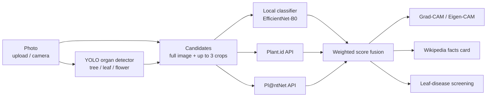

# GreenMind AI

**Explainable plant identification and leaf-disease screening, with a reproducible out-of-distribution evaluation.**

[](LICENSE)


GreenMind is a Flask web app (installable as a PWA) that identifies plants from a photo or the live camera, screens
leaves for disease, shows *why* the model decided with Grad-CAM / Eigen-CAM heat maps, and attaches a cited facts card.
This repository also contains every script and notebook used to evaluate its models on photographs they have never
seen: a temporal split of iNaturalist data and a lab-to-field test for leaf disease.

---

## Contents
- [Features](#features)
- [Architecture](#architecture)
- [Results](#results)
- [Quick start](#quick-start)
- [Configuration](#configuration)
- [API](#api)
- [Reproducing the experiments](#reproducing-the-experiments)
- [Project structure](#project-structure)
- [Limitations](#limitations)
- [Data and licences](#data-and-licences)
- [Citation](#citation)

## Features
- **Multi-source identification**: a local classifier fused with the Plant.id and Pl@ntNet APIs (used only when keys are configured), with weighted score fusion over the full image and up to three detected organ crops.
- **Organ detection**: a YOLO detector (tree / leaf / flower) proposes crops and passes an organ hint to the hosted services.
- **Leaf-disease screening**: 15 PlantVillage classes for pepper, potato and tomato; whole-image, detector and hybrid (leaf-crop) modes.
- **Explanations**: Grad-CAM (class-specific) and Eigen-CAM (class-agnostic) overlays computed on the same classifier that made the prediction.
- **Facts card**: summary, common names, distribution, uses and cautions from the matching Wikipedia article, with the source link.
- **User features**: sign-up / login, saved scans ("My Plants"), feedback on wrong predictions, weather-aware care precautions.

## Architecture



Fusion: for every label, each source contributes its best score over all candidates, weighted by
`W_PLANTID = W_PLANTNET = 1.0` and `W_LOCAL = 0.6`; the result is normalised to probabilities.
Predictions below `CONFIDENCE_THRESHOLD` are reported as uncertain.

## Results

All numbers come from the Kaggle notebooks in [`notebooks/`](notebooks) (logs in [`results/logs/`](results/logs)).
95% confidence intervals are bootstrap intervals over test images.

### Species identification (iNaturalist, temporal split)
Pool A = research-grade CC-licensed observations uploaded **before** 1 Sep 2025 (training data);
Pool B = observations uploaded **after** 3 Sep 2025, i.e. after the app's original model was saved.

| Model | Classes | In-distribution test | Pool B (future uploads) |
|---|---:|---:|---:|
| Original app model (ResNet-18) | 1,106 | – | 22.0% |
| ResNet-18 (retrained) | 958 | 64.9% | 58.2% |
| **EfficientNet-B0 (retrained, now the app default)** | 958 | **76.0%** | **69.0%** (top-5 85.9%) |

### Leaf disease: lab vs. field
PlantVillage test = 3,095 lab images; PlantDoc = 102 field photographs of the same 12 classes.

| Model | PlantVillage (lab) | PlantDoc (field) |
|---|---:|---:|
| EfficientNet-B0, 3 seeds | 99.87 ± 0.06% | 28.4 ± 2.6% |
| ResNet-18, 3 seeds | 99.69 ± 0.05% | 28.8 ± 2.8% |
| **EfficientNet-B0 + 842 PlantDoc field photos (now the app default)** | 99.74% | **49.0%** |

Further findings:
- **Calibration:** temperature scaling fitted on field photos cuts the expected calibration error from 0.27 to 0.07; fitted on lab photos (the usual practice) it rises to 0.61.
- **Abstention:** answering only the 50% most confident field photos raises accuracy on those from 29% to 41%.
- **Shortcut test:** with the central 49% of each PlantVillage image blacked out, accuracy is still 50% (chance 6.7%).
- **Speed:** 31–42 ms per image on a 2-thread CPU for every local model.

## Quick start

Requirements: Python 3.10+, [Git LFS](https://git-lfs.com) (model weights are stored with LFS), MySQL for user accounts.

```bash
git lfs install
git clone https://github.com/mubashir20023/greenmind-ai
cd greenmind-ai

python -m venv .venv
source .venv/bin/activate          # Windows: .venv\Scripts\activate
pip install -r requirements.txt

cp .env.example .env               # Windows: copy .env.example .env
# edit .env: DATABASE_URL, SECRET_KEY and (optional) API keys

python -m app.main                 # http://localhost:5000
```

Production: `gunicorn -w 1 --threads 4 -b 0.0.0.0:5000 app.main:app`.

### Free hosting on Google Cloud Run
Cloud Run's monthly free allowance covers a demo; the app needs about 4 GB of memory, so tiny free tiers with
512 MB (e.g. Render free) are not enough. In [Google Cloud Shell](https://shell.cloud.google.com):
```bash
git clone --depth 1 https://github.com/mubashir20023/greenmind-ai
cd greenmind-ai/deploy/cloudrun
bash deploy.sh <YOUR_PROJECT_ID>
```
The script builds the container from this repository, deploys it with 2 vCPU / 4 GB, scales to zero when idle
(the first request after a pause takes ~30-60 s) and caps it at one instance.
[`deploy/huggingface/`](deploy/huggingface) contains an equivalent setup for Hugging Face Spaces (Docker Spaces now need a paid plan).

Without an external `DATABASE_URL` the hosted app uses SQLite, so accounts and saved plants reset when a new instance starts.

If the weights show up as ~130-byte files after cloning, run `git lfs pull` inside the project folder.

## Configuration
All settings live in `.env` (see [`.env.example`](.env.example)); nothing secret is committed.

| Variable | Default | Purpose |
|---|---|---|
| `DATABASE_URL` | `mysql+pymysql://root:@localhost/plant-fyp` | SQLAlchemy connection string |
| `SECRET_KEY` | random per start | Flask session key; set it in production |
| `MODEL_NAME`, `CKPT_PATH`, `IDX2_PATH` | auto | Local species model; the retrained EfficientNet-B0 is used when its files exist |
| `HEALTH_MODE` | `classifier` | `classifier`, `detector` or `hybrid` (leaf crops) |
| `HEALTH_CLF_WEIGHTS`, `HEALTH_ARCH` | auto, `efficientnet_b0` | Disease model; the field-trained model is used when present |
| `PLANT_ID_API_KEY`, `PLANTNET_API_KEY` | empty | Enable the hosted identification services |
| `W_PLANTID`, `W_PLANTNET`, `W_LOCAL` | 1.0, 1.0, 0.6 | Fusion weights |
| `YOLO_CONF`, `YOLO_MIN_AREA_FRAC` | 0.25, 0.04 | Organ-detector gate |
| `CONFIDENCE_THRESHOLD` | 0.55 | Below this, answers are flagged as uncertain |
| `OPENWEATHER_API_KEY`, `OPENAI_API_KEY` | empty | Optional weather and care-tip services |

## API

| Method | Route | Body | Returns |
|---|---|---|---|
| `POST` | `/identify` | multipart `file` | best label, alternatives, facts card |
| `POST` | `/explain?method=gradcam\|eigen` | multipart `file` | transparent PNG heat map |
| `POST` | `/api/health` | multipart `image` or JSON base64 | disease status, top classes, heat maps |
| `POST` | `/feedback` | multipart `file` + `meta` JSON | `{ "ok": true }` |
| `GET` | `/api/weather?city=Karachi` | – | current weather |
| `GET` | `/diag` | – | which models and services are loaded |

```bash
curl -F "file=@leaf.jpg" http://localhost:5000/identify
```

## Reproducing the experiments
Everything runs on free Kaggle GPUs; see [`RUN_EXPERIMENTS.md`](RUN_EXPERIMENTS.md) for step-by-step instructions.

| Notebook | What it does | Accelerator / time |
|---|---|---|
| [`01_build_dataset_and_test_deployed_model`](notebooks/01_build_dataset_and_test_deployed_model.ipynb) | Downloads the iNaturalist pools A and B | CPU, ~6 h |
| [`02_train_species_models`](notebooks/02_train_species_models.ipynb) | 958-species split, ResNet-18 and EfficientNet-B0, temporal test, original-model test | T4, ~4.5 h |
| [`03_disease_lab_to_field`](notebooks/03_disease_lab_to_field.ipynb) | PlantVillage training, PlantDoc field test | T4, ~1.2 h |
| [`04_disease_improvements`](notebooks/04_disease_improvements.ipynb) | Extra seeds, field-data training, calibration, abstention, occlusion test | T4, ~2.6 h |
| [`05_leaf_detector`](notebooks/05_leaf_detector.ipynb) | YOLO leaf detector from PlantDoc boxes, leaf-crop test, app model bundle | T4, ~1.5 h |

Key scripts in [`tools/`](tools): `inat_fetch_species.py` (dataset download with temporal split),
`make_split.py` (seeded, de-duplicated splits), `train_classifier.py`, `evaluate.py` (accuracy, F1, calibration,
bootstrap CIs, latency), `disease_extras.py`, `plantdoc_leaf_yolo.py`.

## Project structure
```
app/            Flask app: identification, fusion, disease screening, explanations, facts, auth
web/            HTML templates, JS, CSS, PWA manifest and service worker
models/         class maps and model weights (Git LFS)
runs/detect/    YOLO organ detector weights (Git LFS)
tools/          dataset, training and evaluation scripts
notebooks/      Kaggle notebooks 01-05 used for the paper
results/logs/   raw logs of every experiment run
scripts/        database migration helpers
```

## Limitations
- The field test covers 102 PlantDoc photographs in 12 classes; its confidence intervals are wide.
- The disease model covers only pepper, potato and tomato.
- The hosted Plant.id / Pl@ntNet services and the fused output were not evaluated (paid API access).
- iNaturalist research-grade labels are community-verified but not error-free; 22 of the original 1,106 species names could not be matched automatically.
- GreenMind gives guidance only and does not replace an expert diagnosis.

## Data and licences
- Code: [MIT](LICENSE).
- iNaturalist photographs: only CC0, CC-BY, CC-BY-SA and CC-BY-NC images are used; the download script records the observation id, photographer and licence of every image. Images are not redistributed in this repository.
- [PlantVillage](https://arxiv.org/abs/1511.08060) and [PlantDoc](https://github.com/pratikkayal/PlantDoc-Dataset) are used under their own licences and are downloaded by the notebooks.

## Citation
If you use this code or the evaluation protocol, please cite it (see [`CITATION.cff`](CITATION.cff)):

```bibtex
@software{greenmind_ai,
  author = {Ahmed, Mubashir},
  title  = {GreenMind AI: Explainable Plant Identification and Disease Screening},
  year   = {2026},
  url    = {https://github.com/mubashir20023/greenmind-ai}
}
```

## Acknowledgements
[iNaturalist](https://www.inaturalist.org) contributors, the PlantVillage and PlantDoc authors,
[timm](https://github.com/huggingface/pytorch-image-models), [pytorch-grad-cam](https://github.com/jacobgil/pytorch-grad-cam),
[Ultralytics YOLO](https://github.com/ultralytics/ultralytics), and Kaggle for free GPU time.
